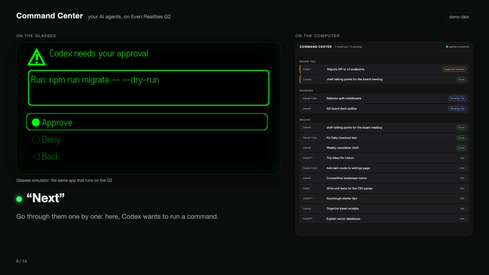

# Command Center

**Your AI agents, on your glasses.** Run Claude Code and Codex from
[Even Realities G2](https://www.evenrealities.com/) smart glasses, by voice, while you walk around. See what needs
you, approve a command, answer a question, talk to a session. Everything runs on your own Mac.

> This open-source version covers the harnesses with supported programmatic interfaces: Claude Code (Anthropic's
> Agent SDK) and Codex (its app server). My private build also drives Claude Cowork and ChatGPT, but they have no
> supported API, so those parts stay out of this repository until they do.



*Left: the G2 display (simulator, running the same app as the glasses). Right: the same sessions on the Mac.
All sessions shown are demo data.*

---

## Why we built it

AI agents now do long, multi-step work on their own: a Claude Code refactor, a Codex migration, a Cowork task
that builds a deck, a ChatGPT research question. They still stop to ask: *may I run this command? which option?
is this what you meant?* Each time, the work waits until you sit back down at the laptop.

We wanted the opposite: leave the agents running, go for a walk, and stay in the loop. Smart glasses are the
right surface for that. They're always on, glanceable and hands-free, as long as the interface is built for a
small monochrome display and a voice you use on the street.

## Where it fits among G2 apps

Plenty of good community projects already connect AI to the G2. Most of them do one of three things well:
- **one agent in a terminal:** they stream a single terminal agent's output to the lens;
- **your own chat model:** they swap your own model in for the built-in assistant;
- **one framework's status:** they show a status display for one agent framework.

We kept running into the same gaps:

| Gap we kept hitting | What Command Center does |
|---|---|
| One harness at a time | **One inbox across harnesses:** Claude Code and Codex side by side, with one "what needs me" list across both, and a provider interface for adding more |
| New sessions only, started from the glasses | **Your existing sessions:** the ones you started at your desk, opened where you left off, resumed and steered |
| Agents ask for permission, the glasses can't answer safely | **Approvals and questions by voice**, with a confirm step. Approving needs the word "approve"; a stray "yes" never runs anything |
| A wall of terminal text on a 576×288 display | **Screens designed for the lens:** icons, status glyphs, short rows, and big type that switches on by itself while you walk |
| Cloud speech, or none | **Speech on the Mac:** local speech-to-text for short commands, cloud only for long dictation (optional), a different voice per harness |
| Only works at home | **Works over cellular** through your own Tailscale network; replies arrive as notifications when the phone is locked |

## Features

- **Command center home:** what needs you, what's running, the latest sessions, every harness with its count.
  It also shows a warning row when something is disconnected.
- **Voice, two ways:**
  - **Push to talk:** hold the temple and speak.
  - **Free talk:** hands-free. It only reacts to your own voice and never hears its own replies.
- **What's on screen is what you can say:**
  - "Open refactor auth middleware" or "the second one" picks a row on screen.
  - "Open Codex migration" searches that harness first.
  - "What needs me", "next", "approve", "deny", "option B", "stop", "read it", "help".
- **Talk to a session:** inside a session, anything you say becomes a message to that agent (after a confirm).
- **Reasoning on demand:** open a session's steps (tool calls, commands) and drill into one.
- **Walking mode:** big text that switches on by itself when the glasses detect you walking, and off again when
  you stop.
- **System check:** "system check" lists every moving part and what to do if one is down.
- **Runs itself:** a supervisor restarts anything that crashes, and the whole stack starts when you log in.

## How it works

```
G2 glasses ⇄ Even app on the phone ⇄ apps/glasses (thin web app: draws pages, sends taps/audio)
                                         ⇅ wss:// over your Tailscale network
                                    apps/gateway ── services/voice (speech ⇄ text, 127.0.0.1 only)
                                         ⇅ local Unix socket
                                    apps/agentd: one session layer for every harness
                         ┌────────────────────┴────────────────────┐
                    Claude Code                                  Codex
              Agent SDK (official)                        app-server (official)
```

**Design rules (each one came from a real bug):**
- **Identity is the harness's own id, never a title.**
- **One writer per session.** Two clients can't send to the same session at once.
- **Push, don't poll.** Screens draw from what is known and update in the background.
- **Fail closed.** If a page structure or an approval target is uncertain, it does nothing and says so.
- **No language model decides what runs.** Voice commands are rule-based with fuzzy matching, and every action
  asks first.

More in [`docs/`](docs).

## What you need

| | Needed for | Notes |
|---|---|---|
| A Mac (Apple Silicon) | everything | Tested on macOS 26. Local speech models use MLX. |
| Even Realities G2 + the Even app | the glasses | Even Hub **developer mode** to load the app (sign in at hub.evenrealities.com). |
| Node 22 | everything | Installed inside the project by `npm install`. Nothing global. |
| [uv](https://docs.astral.sh/uv/) | voice | Python and packages stay inside `services/voice`. |
| Claude Code + an Anthropic API key | Claude Code sessions | Through the Agent SDK. The key lives in the macOS Keychain (see Install). |
| Codex (the ChatGPT desktop app or the Codex CLI), signed in | Codex sessions | Talks to the bundled `codex app-server`. **No API key.** |
| [Tailscale](https://tailscale.com/) + `tailscale cert` | connecting the phone | Your own private network, also over cellular. The phone connects only over TLS (set `gateway.glasses.allowPlainLan` to allow plain Wi-Fi at home). Use `--accept-dns=false` if you run another VPN. |
| OpenAI API key (optional) | long dictation, voice fallback | Stored in the macOS Keychain, never in a file. Without it, everything stays local. |

## Install

```sh
git clone https://github.com/lmarquina/command-center.git && cd command-center
npm install                      # project-local Node 22 and dependencies
npm run voice:setup              # speech service (downloads ~5 GB of models on first start)
# Anthropic API key for Claude Code: copy the key, then
security add-generic-password -U -s command-center-anthropic -a "$USER" -w "$(pbpaste)" && pbcopy < /dev/null
```

**Run it:**

```sh
npm run dev                      # start everything in the background (logs: run/logs/)
npm run qr -w @command-center/glasses    # pairing QR: Even app → Even Hub → Scan QR
npm run login-item -- install    # optional: start at login
```

Then say **"system check"** on the glasses.

<details>
<summary><b>Connecting the phone (Tailscale), and spoken replies on a locked phone</b></summary>

- **Phone connection:** install Tailscale on the Mac and the phone. Then run
  `tailscale cert <your-mac>.<tailnet>.ts.net` and put `ts.crt` and `ts.key` in `run/tls/`. The glasses app and
  gateway switch to https/wss on that name.
- **Locked phone:** iOS mutes the glasses' web view when the phone is locked. To get replies as notifications,
  open `https://<your-mac>.<tailnet>.ts.net:3100/push/` on the phone, add it to the Home Screen and allow
  notifications.
- **OpenAI key:** copy the key, then run
  `security add-generic-password -U -s command-center-openai -a "$USER" -w "$(pbpaste)"`.

</details>

**Try it without glasses or accounts:** set `"demo": true` in `config/local.json`, run `npm run dev`, then
`npm run sim`. This gives you made-up sessions and the official G2 simulator. That's how the screenshot above was
made (`tools/demo/record.mjs` records the video).

## Settings

All settings are in `config/default.json`. Override them per machine in `config/local.json` (never committed).
You can set the ports, which harnesses are enabled, voices per harness, speech routing (short commands local,
long dictation cloud) and screen timing.

## Privacy, safety and limits

- **Local by design:**
  - The services listen on `127.0.0.1`. The glasses endpoint is the only exception: it needs a token and accepts
    only its own app's origin.
  - Session content stays on your Mac and your own Tailscale network.
- **Official interfaces only:** Claude Code through Anthropic's Agent SDK with your own API key (as Anthropic
  asks of third-party tools), Codex through its app server.
- **Every action asks first.** Sending, approving, creating and stopping all need a tap or a spoken "do it".
  Approvals need the word "approve".
- **Single user, macOS only, early.** It's tested daily by one person, and it isn't hardened for shared or
  hosted use.

## Project layout

| Path | What |
|---|---|
| `packages/core` | session layer: ids, events, single-writer locks, attention list, config |
| `packages/providers/*` | one adapter per harness, plus a demo provider |
| `apps/agentd` | daemon that hosts the providers on a local socket, and its CLI (`npm run agentctl`) |
| `apps/gateway` | web UI, glasses endpoint, voice commands, screens, notifications |
| `apps/glasses` | the Even Hub app (thin client) |
| `services/voice` | speech-to-text / text-to-speech (MLX, optional OpenAI fallback) |
| `packages/stack` | supervisor, `npm run dev`, login item |
| `tools/` | publishing and demo recording |

`npm test` runs every package's tests.

## Contributing

Issues and ideas are welcome. This repository is published from a private working copy, so pull requests are
not merged here directly. If one is accepted, its changes go into the working copy with you credited as
co-author. They appear here with the next update, and the pull request is closed with a note.

## License

MIT. See [LICENSE](LICENSE). Not affiliated with Even Realities, Anthropic or OpenAI.
